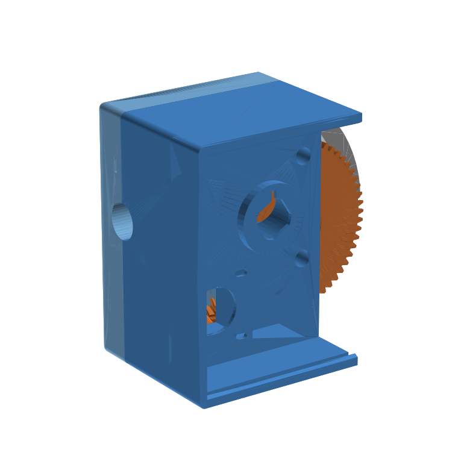

# Thermostat

This repo contains the files for my DIY Home Assistant-enabled thermostat project.



## Motivation
I want to be able to control the temperature in my studio using Home Assistant. Sadly, the valves of the radiators in my studio are not standard thermostatic valves, and so I cannot use COTS thermostats for this. Because I am in a rental building and cannot locate the water shutoff valve for my apartment, I cannot simply replace the valve with something more modern either. So I'm making my own DIY thermostat.

## The Plan
The valve on my radiators are rotationally actuated, and require a fairly high torque (since they are pretty old).
To actuate one, I am going to use a NEMA17 stepper motor, driven by a LilyGO TTGO T-Motor ESP32 driver board.
The parts will be 3D-printed (at least for the first iterations), and for ease of integration into Home Assistant, I will use ESPHome for the firmware.

## What it is now

A clamp-on actuator for one old rotary radiator valve (about 373° from closed
to open), and its firmware:

- A **NEMA17 stepper** (SY42STH38-1684A) turns the valve spindle through a
  **15:59 herringbone gear pair** printed in PETG (3.93:1, module 1.25, 50 mm
  centres). A two-part printed housing clamps onto the parts of the valve that
  don't turn.
- A **LilyGO TTGO T-Motor** sits on the back of the motor: an ESP32, a TMC2209
  stepper driver (run quietly, in StealthChop) and an MT6816 magnetic encoder
  that reads the motor shaft.
- **ESPHome firmware** with a custom C++ component (`valve_actuator`). It has no
  limit switches: it finds the closed end by stalling the motor at a low
  current and seeing it with the encoder. It remembers the position across
  reboots, follows the valve when it's turned by hand, and after a power cut it
  closes fully, opens to 5 % and raises an alert in Home Assistant.
- In **Home Assistant** it's a thermostat (`climate.room_thermostat`, with Home,
  Sleep and Away presets that can each follow a different temperature sensor)
  and a valve with a 0 to 100 % position. The board's three buttons set the
  valve to 0, 50 and 100 %. An automation turns the heating off while a window
  is open.

Why it ended up like this (direct drive was too weak, why not a worm, why the
limit switches went, why the encoder and not StallGuard, and so on) is in
[`docs/design-decisions.md`](docs/design-decisions.md).

## Project layout

```text
thermostat/
├── CLAUDE.md                # notes for coding agents
├── docs/
│  └── design-decisions.md   # what was decided, when, and why
├── fw/                      # ESPHome firmware (see fw/README.md)
│  ├── thermostat.yaml       # the device config
│  ├── secrets.yaml.example  # copy to secrets.yaml
│  └── components/valve_actuator/  # custom C++ component: TMC2209, MT6816, valve, thermostat
├── hw/                      # hardware
│  ├── BOM.md                # everything to buy and print
│  ├── cad/                  # FreeCAD sources, STEP/STL exports, assembly guide (see hw/cad/README.md)
│  ├── datasheets/
│  ├── 3d-printed-gears.md   # gear reduction research: options and printing tips
│  └── limit-switches.md     # limit switch wiring on the T-Motor P1 header (dropped, kept for reference)
└── sw/                      # Home Assistant side (see sw/README.md)
   └── automations/          # automations, pasted into Home Assistant by hand
```

The PlatformIO bring-up firmware used for the first torque test is on the
`archive/torque-test` branch.

## Building one

Each step links to the detailed guide.

### 1. Get the parts

See [`hw/BOM.md`](hw/BOM.md). In short: the T-Motor board, the NEMA17, a 12 V
supply, a USB-to-serial downloader for the first flash, a handful of M3 screws
and nuts, a grub screw, a piece of acrylic, and PETG filament.

### 2. Check that it fits your valve

The housing is built around one specific valve: an 11 mm round spindle, a
Ø19.5 mm bonnet with flats 17 mm apart, a ~Ø28 mm body and a 25 mm union nut.
Print the four small fit tests in `hw/cad/stl/fit-tests/` and try them on your
valve and motor before printing anything big. If your valve is different,
[`hw/cad/README.md`](hw/cad/README.md#how-it-mounts-on-the-valve) says which
FreeCAD features to change.

### 3. Print

Gears in PETG at 0.07 mm layers and solid (100 % infill or enough walls), the
housing in PETG or ASA at 0.2 mm. Not PLA: the valve body gets too hot. The
STLs are already in print orientation. Full settings:
[`hw/cad/README.md`](hw/cad/README.md#print-settings).

### 4. Assemble

Motor into the front housing half (screws loose), pinion onto the motor shaft,
housing over the valve, big gear onto the spindle with its grub screw, slide
the motor to set the gear mesh, close the back half around the pipe, grease the
teeth, fit the window. Step by step:
[`hw/cad/README.md`](hw/cad/README.md#assembly).

### 5. Wire

There's very little wiring, because the driver and encoder are on the board:

| From | To | Notes |
| --- | --- | --- |
| Motor's 4-wire cable | T-Motor motor connector | The board mounts on the back of the motor, with the MT6816 facing a magnet on the motor shaft's back end. If "open" turns the wrong way, set `invert_direction: true` in `fw/thermostat.yaml` |
| 12 V DC supply + | P1 pin 1 (V+) | 9 to 12 V. Feeds the motor and the board. The TMC2209 doesn't answer until this is on, so USB/serial power alone isn't enough to move anything |
| 12 V DC supply − | P1 pin 2 (GND) | |
| USB-to-serial downloader | the board's programming pins | First flash only; afterwards updates go over Wi-Fi. With EN and G0 wired, the downloader resets the board into the bootloader by itself |

P1 is the 6-pin JST connector. Its other pins (COM, EN, STP, DIR) are spare
inputs and stay unconnected; [`hw/limit-switches.md`](hw/limit-switches.md) has
the full pinout. The board's DIP switch MS1/MS2 sets the TMC2209's UART
address; the firmware scans for it, so any setting works.

Keep the driver below about 1.2 A: without a heatsink it overheats within
seconds above that. The firmware runs at 1.0 A and calibrates at 0.6 A.

### 6. Flash

You need ESPHome (checked with 2026.11.0: `pip install esphome`).

```sh
cd fw
cp secrets.yaml.example secrets.yaml   # Wi-Fi, fallback AP password, API key
esphome run thermostat.yaml --device /dev/ttyACM0 --upload_speed 115200  # first time, over the downloader
esphome run thermostat.yaml --device thermostat.local                    # afterwards, over Wi-Fi
```

460800 baud drops the link on this board, hence `--upload_speed 115200`. If
your downloader doesn't drive EN and G0, hold BOOT, tap RESET, release BOOT.
The device comes up as `thermostat.local`.

Before flashing, change the `substitutions:` at the top of `thermostat.yaml`
to your own Home Assistant temperature and humidity sensors (they can also be
changed later from Home Assistant). Details: [`fw/README.md`](fw/README.md).

### 7. Add it to Home Assistant

1. Settings > Devices & services. The ESPHome device is usually discovered on
   its own; otherwise add the ESPHome integration with host `thermostat.local`.
   Paste `api_encryption_key` from `secrets.yaml` when asked.
2. Give the device a name and an area. Here it's "Room thermostat", which makes
   the entities `climate.room_thermostat` and
   `valve.room_thermostat_radiator_valve`.
3. On the device page, check **Temperature sensor**, **Sleep temperature
   sensor** and **Away temperature sensor**: each holds the entity ID of the
   Home Assistant sensor the thermostat follows (main, in Sleep, in Away).
4. Add the window automation from [`sw/`](sw/README.md), with your own window
   sensors.

All the device's entities are listed in
[`fw/README.md`](fw/README.md#home-assistant).

### 8. Set the end stops

With the valve mounted and powered:

1. Press **Jog open 10°** once, so the encoder learns which way it turns.
2. Turn the valve to fully closed (by hand on the exposed gear, or with the jog
   buttons) and press **Set closed here**.
3. Turn it to fully open and press **Set open here**.

Then press **Calibrate valve** to check that it finds the closed end on its
own. It should report "End found at ... (motor stalled)" close to 0°. If it
stops early, raise **Calibration current**; if the gear slips on the spindle
instead, lower it. See
[`fw/README.md`](fw/README.md#calibration).

### 9. Use it

Set a temperature or a preset on the thermostat. Home is 23.5 °C, Sleep
20.5 °C, Away 18.5 °C; change them in `thermostat.yaml`. Moving the valve
directly (in Home Assistant or with the board buttons) holds it there until
the thermostat's mode, target or preset changes next. How the controller
works and how to tune it: [`fw/README.md`](fw/README.md#thermostat).

## Known issues and not done yet

- The big gear slips on the valve's round spindle at the end stops (grub screw
  only, no flat). The low calibration current works around it. A flat on the
  spindle, a heat-set insert or a second grub screw would fix it properly. The
  pinion has a plain round bore too. See
  [`hw/cad/README.md`](hw/cad/README.md#known-issues).
- Stall detection only runs during calibration and power-cut recovery, not
  during normal moves.
- The thermostat needs a temperature sensor from Home Assistant; there's no
  sensor on the board yet.
- Schedules and presence (Away while nobody's home, Sleep at night) aren't
  built yet. The presets are there for them.
