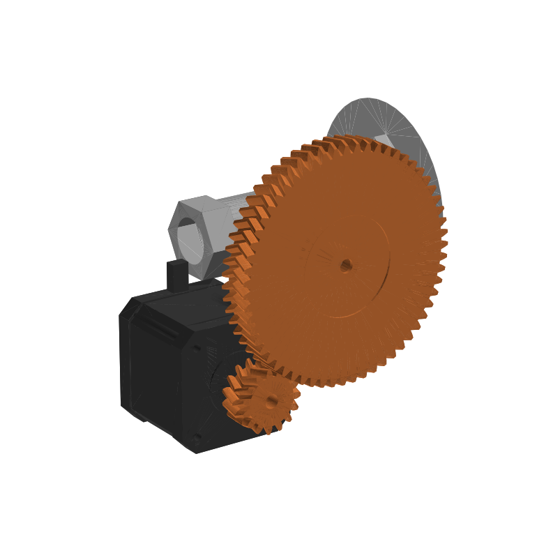
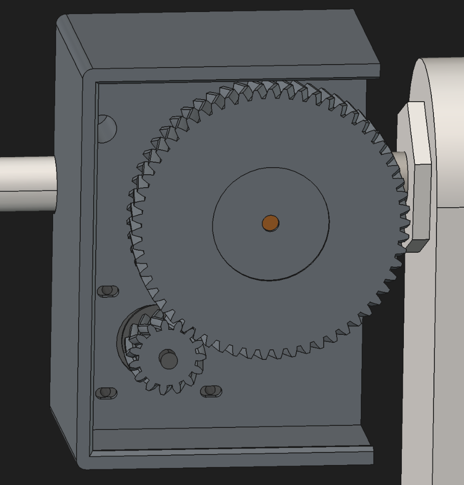

# CAD: radiator valve actuator

A NEMA17 stepper turns an old rotary radiator valve through a 15:59 herringbone
gear pair. The housing clamps onto the parts of the valve that don't turn and
the big gear sits on the valve spindle.




The sources are FreeCAD 1.1 files. STEP and STL exports sit next to them so you
can print or import the parts without FreeCAD. The design is built around one
specific valve (see [How it mounts on the valve](#how-it-mounts-on-the-valve)), so
**print the fit tests on your own valve before printing the housing**.

Background on why this gear pair was chosen: [`../3d-printed-gears.md`](../3d-printed-gears.md).
Firmware and calibration: [`../../fw/`](../../fw/).

## Files

```text
hw/cad/
├── freecad/                        # editable sources (FreeCAD 1.1)
│   ├── assembly.FCStd              # everything together, links the files below
│   ├── valve_gear.FCStd            # 59-tooth gear on the valve spindle
│   ├── pinion.FCStd                # 15-tooth gear on the motor shaft
│   ├── housing.FCStd               # housing_front_2 + housing_back_2 (current), plus older bodies
│   ├── ref_motor_and_switch.FCStd  # reference only: NEMA17 + T-Motor board, microswitch
│   └── ref_valve_and_radiator.FCStd # reference only: the valve, pipe, radiator and wall
├── step/                           # for other CAD tools, in assembly coordinates
│   ├── assembly.step               # valve, motor, both gears, both housing halves
│   ├── valve_gear.step
│   ├── pinion.step
│   ├── housing_front.step
│   └── housing_back.step
├── stl/                            # for slicing, already in print orientation
│   ├── valve_gear.stl
│   ├── pinion.stl
│   ├── housing_front.stl
│   ├── housing_back.stl
│   └── fit-tests/                  # small, quick prints to check fits first
└── img/                            # pictures for this README
```

Keep the `freecad/` files together in one folder. `assembly.FCStd` finds the
other files by name relative to itself.

To edit the gears you need the **FreeCAD Gears workbench** (`freecad.gears`,
install it from the Addon Manager). Without it the gears still open and export,
but you can't change their parameters.

## Parts list

### Printed

| Part | STL | Qty | Size (mm) | Notes |
|---|---|---|---|---|
| Valve gear | `valve_gear.stl` | 1 | Ø82.2 × 12 | 59 teeth, 11.4 mm bore for the valve spindle |
| Pinion | `pinion.stl` | 1 | Ø22.8 × 12 | 15 teeth, 5.01 mm round bore for the motor shaft |
| Housing, front | `housing_front.stl` | 1 | 88 × 122 × 62 | holds the motor, keys onto the valve |
| Housing, back | `housing_back.stl` | 1 | 88 × 122 × 20 | closes around the pipe and union nut |

### Bought

| Item | Qty | Notes |
|---|---|---|
| NEMA17 stepper, SY42STH38-1684A | 1 | datasheet in [`../datasheets/`](../datasheets/) |
| LilyGO TTGO T-Motor (ESP32 + TMC2209) | 1 | mounts on the back of the motor |
| 9 to 12 V power supply | 1 | for the motor and board |
| M3 screws, motor to housing | 4 | through the slotted holes in the front half's motor plate (2 mm plate, so about M3 × 6 to 8) |
| M3 × 20 socket head screws | 3 | join the two halves |
| M3 square nuts (DIN 562, 5.5 × 1.8 mm) | 3 | slide into the 2.0 × 5.8 mm slots in the back half |
| Grub screw | 1 | holds the valve gear on the spindle (not modelled, see [Known issues](#known-issues)) |
| Plexiglass (acrylic) window, about 118 × 90 × 5 mm | 1 | closes the front of the housing. Not modelled, and the size comes from an offcut, so measure your printed front half before cutting one |
| PTFE or silicone grease | a little | for the gear teeth, plastic-safe |

Screw counts and slot sizes are measured from the CAD. Lengths are estimates
from the hole depths, so check them against your hardware before ordering.

## Gear data

| | Pinion | Valve gear |
|---|---|---|
| Teeth | 15 | 59 |
| Normal module | 1.25 | 1.25 |
| Transverse module | 1.3513 | 1.3513 |
| Pressure angle | 20° | 20° |
| Helix angle | 22.33°, double (herringbone) | 22.33°, double (herringbone) |
| Pitch diameter | 20.27 | 79.73 |
| Tip diameter | 22.77 | 82.23 |
| Root diameter | 17.15 | 76.60 |
| Face width | 12 | 12 |
| Profile shift | 0 | 0 |

- **Ratio 59:15 = 3.93:1.** A hunting-tooth pair, so every tooth meets every
  other tooth and wear evens out.
- **Centre distance 50.00 mm** (motor axis 30 mm across and 40 mm down from the valve axis).
- The generator has zero backlash and 0.25 clearance. Backlash is set at assembly
  by sliding the motor in its slots (see below).
- At about 0.2 N·m from the motor (TMC2209 at ~1.2 A), expect roughly 0.7 N·m
  at the valve.

## Print settings

These follow [`../3d-printed-gears.md`](../3d-printed-gears.md), except the gear layer height, which comes from the working prototype. The STLs are
already rotated to the orientation listed here.

| | Gears | Housing |
|---|---|---|
| Material | PETG (nylon or ASA also fine) | PETG or ASA |
| Layer height | 0.07 mm (what the working prototype uses) | 0.2 mm |
| Walls | 4 to 6, or 100 % infill, so the teeth are solid | 3 to 4 |
| Infill | 100 % (or enough walls to fill the teeth) | 20 to 30 % |
| Orientation | flat, as exported | front: split face down. back: outer face down |
| Supports | none needed | front: yes, under the motor plate and the valve bore. back: only small ones |

- **Use fine layers for the gears.** The prototype's gears were printed at 0.07 mm
  and run very quietly and smoothly. Coarser layers (0.12 to 0.16 mm) work but
  will be noisier.
- **Don't use PLA.** It softens around 55 to 60 °C and the valve body gets hotter than that.
- For the gears, keep the Z seam off the tooth flanks and add a 0.4 to 0.5 mm
  elephant's-foot compensation (or chamfer), otherwise the bottom edge rubs.
- Print the pinion and the gear slice from `fit-tests/` first and check the mesh by hand.

## Fit tests

Quick prints that check the fits that matter, before you spend hours on the
housing. All are in `stl/fit-tests/`.

| File | What it checks | Size |
|---|---|---|
| `valve_key_fit.stl` | the keyed hole that locks the housing onto the valve's bonnet (19.6 mm with 17 mm flats) | 32 × 32 × 4 |
| `valve_spindle_bore_fit.stl` | the gear bore on the 11 mm valve spindle (this test has an 11.5 mm bore, the final gear has 11.4 mm) | Ø20 × 6 |
| `pinion_bore_fit.stl` | the pinion on the 5 mm motor shaft (5.1 mm bore here, 5.01 mm in the final pinion) | Ø22.7 × 3 |
| `valve_gear_slice.stl` | a 3 mm slice of the valve gear, to check the mesh against the pinion | Ø82.2 × 3 |

The bore tests were the last iterations before the final values, so they're a
little looser than the final parts. If they're already loose on your valve, the
final parts will be just right; if they're tight, open up the bores in FreeCAD.

## How it mounts on the valve

The valve this was designed for (modelled in `ref_valve_and_radiator.FCStd`) has,
from the outside in:

1. an **11 mm round spindle** sticking out about 7.5 mm. This is the part that turns,
   about 375° from closed to open;
2. a **Ø19.5 mm bonnet** about 5 mm long, with **two flats 17 mm apart** and a
   small **2 × 4 mm lug** on one side. It doesn't turn;
3. a slightly tapered **valve body**, about Ø28 mm, 23 mm long;
4. a **25 mm hex union nut** onto a **16 mm pipe** that runs sideways to the radiator.

The actuator only grabs the parts that don't turn, and drives the spindle:

- The **front half** slides over the valve body (30 mm bore). A keyed hole at its
  end matches the bonnet's flats and lug, so the housing can't rotate.
- The **back half** closes around the pipe (18 mm hole) and the union nut. Three
  M3 screws squeeze the halves together and clamp the whole thing on.
- The **valve gear** slides onto the spindle (11.4 mm bore, 8 mm long). A 22 mm
  counterbore on the valve side clears the bonnet.

**If your valve is different**, measure those four things and change these
features. Then re-export:

| What | File | Feature |
|---|---|---|
| keyed hole for the bonnet | `housing.FCStd` > `housing_front_2` | `Sketch028` (`Pad021`) |
| bore over the valve body | `housing.FCStd` > `housing_front_2` and `housing_back_2` | start from `Sketch024` / `Sketch034`, the reference sketches with the Ø30 circle that later sketches build on |
| bore for the spindle | `valve_gear.FCStd` | `Sketch002` (Ø11.4) |
| valve reference geometry | `ref_valve_and_radiator.FCStd` > `valve` | `Sketch` to `Sketch011` |

## Assembly

1. **Print the fit tests** and check them on your valve and motor (above).
2. **Fit the motor into the front half** from the inside (the radiator side), with
   the shaft through the 22.5 mm hole in the motor plate. Put in the 4 M3 screws
   but leave them loose: the holes are 3 mm slots so you can set the gear mesh later.
3. **Press the pinion onto the motor shaft**, as close to the motor face as it goes.
   The motor's radial load limit is 28 N at 20 mm from the flange, so closer is better.
4. **Slide the front half over the valve** until the keyed hole sits on the bonnet.
5. **Put the valve gear on the spindle**, counterbore towards the valve, and
   tighten the grub screw.
6. **Set the mesh**: slide the motor in its slots until the gears mesh with a
   hint of backlash (they shouldn't bind anywhere in a full turn), then tighten
   the motor screws.
7. **Close the back half** around the pipe. Slide the 3 square nuts into their
   slots in the back half and put the 3 M3 × 20 screws in from the open gear side
   of the front half.
8. **Grease the teeth** lightly with PTFE or silicone grease, then fit the
   **plexiglass window** over the front of the housing.
9. **Wire it up and calibrate**: see [`../../fw/`](../../fw/). The firmware finds both
   end stops by stall detection, so no limit switches are needed.

## Known issues

- **The valve gear slips on the spindle at the end stops.** The spindle is round
  with no flat, and the gear holds it with a grub screw only. When the firmware
  drives into an end stop to find it, the stall torque at the valve (up to about
  0.8 N·m) is more than a grub screw in plastic holds. Options: a brass heat-set
  insert or captive nut for the grub screw, a second grub screw at 90°, filing a
  flat on the spindle and adding a matching D-flat to the bore, or a lower motor
  current during calibration. The grub screw hole isn't in the CAD yet.
- **The pinion has a plain 5.01 mm round bore**, with no D-flat or set screw.
- **The valve gear sticks out about 11 mm past the side of the housing, on
  purpose.** It lets you turn the valve by hand during a power cut or a Wi-Fi
  problem. The exposed teeth aren't child-safe, so keep that in mind where small
  fingers can reach it.
- `housing.FCStd` also contains the first housing (`housing_front`,
  `housing_back`) and a `window` reference body. Only `housing_front_2` and
  `housing_back_2` are current.
- `assembly.FCStd` still links the old `housing_back` (hidden) and doesn't
  include `housing_back_2`. `step/assembly.step` does include `housing_back_2`.
- FreeCAD's geometry check flags `housing_front_2` as not strictly valid. The STL
  is watertight and slices fine, but other CAD tools may warn when importing the STEP.
- The microswitch in `ref_motor_and_switch.FCStd` is from an earlier plan with limit
  switches ([`../limit-switches.md`](../limit-switches.md)). The current firmware doesn't use it.
